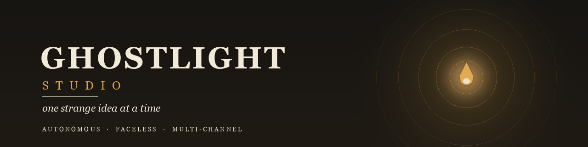
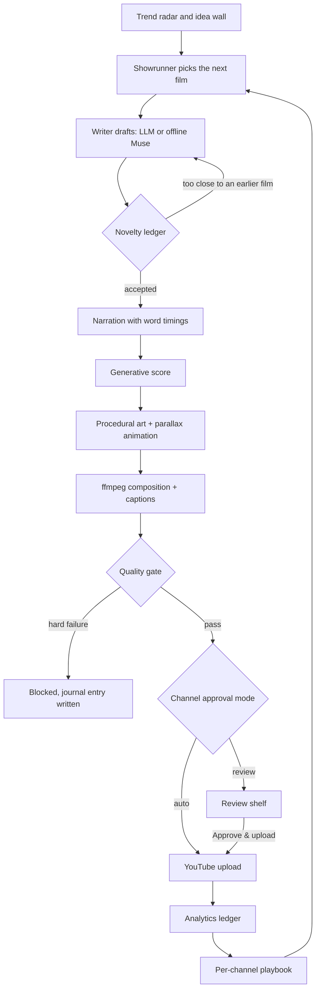

<div align="center">
  <picture>
    <source media="(prefers-color-scheme: dark)" srcset="docs/assets/banner-dark.png">
    <source media="(prefers-color-scheme: light)" srcset="docs/assets/banner-light.png">
    
  </picture>

  <p>
    <strong>An autonomous, faceless film studio for YouTube.</strong><br>
    It writes, narrates, scores, paints, renders, inspects and publishes on its own airtimes —<br>
    with no camera, no stock footage, and no two stories alike.
  </p>

  <p>
    
    
    
    
    
    
    <a href="https://github.com/Monish03905/GHOSTLIGHT_STUDIO/actions/workflows/tests.yml"></a>
  </p>

  <p>
    <a href="#quick-start"><b>Quick start</b></a> ·
    <a href="#how-a-film-is-made">Pipeline</a> ·
    <a href="#the-control-room">Control room</a> ·
    <a href="#the-network">Network</a> ·
    <a href="#the-quality-gate">Quality gate</a> ·
    <a href="#autonomy">Autonomy</a> ·
    <a href="#configuration-atlas">Configuration</a> ·
    <a href="#http-api">API</a> ·
    <a href="#honest-limits">Limits</a>
  </p>
</div>

> **The premise.** A *ghost light* is the bulb left burning on an empty stage so the theatre is never fully dark. This project applies the same idea to a YouTube network: the stage stays lit, the work continues, and nobody has to stand in the room.

Ghostlight is a single machine that runs several editorial voices at once. It researches subjects, writes standalone essays, narrates them with a neural voice, composes its own score, paints every frame procedurally, renders the film, inspects the result against a hard quality gate, and uploads it on each channel's own airtimes — or parks it on a review shelf until you approve it.

You talk to it like a person: *"make a short about deep-sea light"*, *"upload the latest film"*, *"pause the schedule"*, *"set times 10:00, 20:30"*. It answers in plain language, journals what it decided and why, and keeps working while you are away.

**It runs with zero API keys.** The built-in Muse writes, numpy synthesises the score, and the renderer paints. Add an LLM, a premium voice or a Google sign-in only when you want them.

---

## Quick start

```bash
git clone https://github.com/Monish03905/GHOSTLIGHT_STUDIO.git
cd GHOSTLIGHT_STUDIO

python -m venv .venv
source .venv/bin/activate        # Windows: .venv\Scripts\activate
pip install -r requirements.txt

python -m ghostlight serve
```

Open **http://127.0.0.1:8787** — the desk is yours. Three voices are already on **The Network**. Type `make a short about abandoned observatories` in the command bar, or open a channel card and press **Make one now**.

**Requirements:** Python 3.12+, and `ffmpeg`/`ffprobe` on your `PATH` (the renderer and the quality gate both need them).

<details>
<summary><b>Install ffmpeg</b></summary>

```bash
# Windows
winget install Gyan.FFmpeg
# macOS
brew install ffmpeg
# Debian / Ubuntu
sudo apt install ffmpeg
```
</details>

<details>
<summary><b>A natural voice with Piper (recommended)</b></summary>

The operating-system voice sounds robotic. Piper is a small neural TTS that runs locally, offline, with no account:

```bash
pip install piper-tts
# download a voice from https://huggingface.co/rhasspy/piper-voices
#   e.g. en_US-ryan-high.onnx + en_US-ryan-high.onnx.json
# put both files in data/models/piper/ — the studio finds them automatically
```

`voice.provider: piper` is already the shipped default. Prosody is tunable: `piper_length_scale` (speaking rate), `piper_noise`, `piper_noise_w`, `piper_volume`. If Piper is missing the studio falls back to Edge TTS, then the system voice, and says so in the log rather than failing the film.
</details>

<details>
<summary><b>Run headless with Docker</b></summary>

```bash
docker compose up -d
docker compose exec studio python -m ghostlight connect   # first sign-in
```

State, films and OAuth tokens live in `./data` and `./secrets` on the host. The image is `python:3.12-slim` plus ffmpeg and fonts — no display server required.
</details>

<details>
<summary><b>Command line</b></summary>

| Command | What it does |
|---|---|
| `python -m ghostlight serve` | Web desk + the autonomous scheduler |
| `python -m ghostlight make --format long --topic "the physics of honey"` | Produce one film now and watch the log |
| `python -m ghostlight upload [--id …]` | Publish the newest ready film (runs the gate first) |
| `python -m ghostlight clips --id … [--count 3] [--dry-run]` | Preview or queue vertical cuts from a finished film |
| `python -m ghostlight backup` | Write a timestamped SQLite backup into `data/backups/` |
| `python -m ghostlight status` | The state of the studio |
| `python -m ghostlight log -n 50` | The desk log |
| `python -m ghostlight connect` | Link a YouTube channel |
| `python -m ghostlight version` | Version |
</details>

---

## How a film is made



<details>
<summary><b>What happens at each stage</b></summary>

| Stage | Module | What actually happens | Artifact |
|---|---|---|---|
| Idea | `trends.py`, `ideas.py`, `showrunner.py` | A scored shelf of subjects per niche, an idea wall of original pitches, and a playbook-weighted choice with a written rationale | `journal` entry |
| Writing | `scriptwriter.py`, `prompts.py`, `llm.py` | Structured prompt → title, hook, segments, description, tags, thumbnail text; retried against the validator if anything is off | `script` JSON |
| Novelty | `novelty.py` | Fingerprint (premise parts, shingles, title terms) compared with every earlier film; drafts above the similarity floor are rewritten | `fingerprint`, `novelty` |
| Narration | `tts.py` | Per-segment synthesis, word-level timings, loudness normalisation, ducking under the score | `narration.wav`, timings |
| Score | `music.py` | numpy-synthesised pads, chords and pulse, mood-matched and gain-controlled | `music.wav` |
| Art | `visuals.py` | 7 painterly styles × 17 palettes; plate, silhouette midground and drifting foreground composited at different depths | scene plates |
| Render | `render.py`, `captions.py`, `ffmpeg.py` | Camera push, sway, light sweep, grain, karaoke captions, chapter cards, poster and three thumbnails | `film_*.mp4`, `poster.jpg`, `thumbs/*.jpg` |
| Gate | `quality.py` | Deterministic probe of streams, dimensions, bitrate, duration, captions, thumbnail, description, novelty | `quality` JSON |
| Publish | `publish.py`, `youtube.py` | Resumable upload, SRT captions, thumbnail, playlist, hashtags, optional first comment, share kit, RSS | `youtube_id`, `upload_meta` |
| Learn | `showrunner.py` | Analytics become a per-channel playbook that re-weights tomorrow's choices | playbook |
</details>

---

## The control room

The dashboard is plain HTML/CSS/JS with **no build step** — FastAPI serves it, and every panel is driven by live studio state.

| Tab | What lives there |
|---|---|
| **The Desk** | Queue, films in flight, the desk log (server-sent events), and one-click commissions |
| **The Network** | Channel cards, editorial journal, the next planned film per voice, and *Add a voice* |
| **The Radar** | Scored trends per niche, the idea wall, the content calendar, and the AI brain's current reading |
| **The Shelf** | Every film and vertical cut, filterable, with the film drawer for playback, gate, editorial read, clips, languages, share kit and publishing |
| **The knobs** | Settings, YouTube key and schedule, plus **The archive**: storage, export, backup and a guarded prune |

The bell in the masthead keeps durable notices — finished films, gate blocks, review requests, publications, failed localizations, exports and prunes. It survives restarts; the desk log is the transient stream beside it.

<details>
<summary><b>Installable, offline-aware shell</b></summary>

`web/manifest.webmanifest` and `web/sw.js` make the desk installable as a PWA. The service worker caches only the app shell (`/`, CSS, JS, manifest, icons) and never the API, so the UI can open offline while live state always comes from the server. Registration is limited to `https` and `localhost`, and the icons are generated by `scripts/make_icons.py`.
</details>

---

## The network

Three editorial identities ship by default. Each one owns its niches, art direction, cadence and Google account.

| Channel | Owns | Art direction | Air times | Per day |
|---|---|---|---|---|
| **Ghostlight** — *one strange idea at a time* | cosmic, deep sea, liminal places | aurora, tide, dusk | 09:30, 19:30 | 2 |
| **The Quiet Machine** — *small machines, large questions* | quiet tech, human mind, everyday physics | neon, ink, paper | 12:30 | 1 |
| **Field Notes from Elsewhere** — *the past is a foreign country* | forgotten history, natural world | paper, ink, ember | 17:00 | 1 |

Every card on **The Network** edits the same contract:

| Control | Effect |
|---|---|
| **Niches** | The idea territories this voice is allowed to draw from |
| **Art direction** | Palettes and styles it may paint in |
| **Formats** | Shorts, long form, and the rotation between them |
| **Airtimes** | `HH:MM` slots in `schedule.timezone` (`auto` = system time) |
| **Films per day** | Per-channel production ceiling |
| **Visibility** | Private, unlisted or public at upload time |
| **Approval** | `auto` publishes alone; `review` parks every film until you press *Approve & upload* |
| **Voice, tone, audience, CTA** | Fed into every script prompt for that persona |

<details>
<summary><b>Approval modes</b></summary>

| Mode | Behaviour |
|---|---|
| `auto` | The film publishes on its airtime (or immediately, if you press publish), after the gate passes |
| `review` | The film stops at stage `review`; the drawer offers **Approve & upload**, which re-checks the gate and queues the publish |

A channel created from a template is `auto`; choose `review` while you are still tuning a voice's taste.
</details>

---

## The quality gate

No render reaches YouTube without a deterministic inspection. The gate measures the file — it does not ask a model for an opinion.

| Check | Hard failure | Note only |
|---|---|---|
| `title` | Missing or empty | — |
| `file` | Missing render, or clearly truncated | — |
| `picture` | No video stream | Below 720p |
| `sound` | No audio stream | — |
| `probe` | — | ffprobe could not read the container |
| `duration` | Zero length | Outside the format's floor/ceiling |
| `bitrate` | — | Thin for the length |
| `captions` | — | No caption track |
| `thumbnail` | — | No thumbnail on disk |
| `description` | — | Under 120 characters of search text |
| `novelty` | — | Below 0.35 — the idea echoes recent films |
| `channel` | — | Film is not attached to a voice |

Hard failures set the film to `blocked` and write the reason to the journal. Notes are shown in the film drawer and do not stop publication. `GET /api/videos/{id}/quality?refresh=true` re-inspects an existing film on demand.

---

## Autonomy

- **One worker, one queue.** Commissions come from you, from the scheduler, or from restart recovery. They are produced one at a time.
- **The showrunner** chooses what each voice makes next, weighing niches and art directions by what actually performed, rotating formats, and recording every decision with its rationale.
- **The scheduler** ticks every 20 seconds. Each channel fires its own airtimes inside a 45-minute catch-up window and respects a minimum gap. Only channels with a Google sign-in auto-produce, so films never pile up for a voice you never connected.
- **It pauses itself.** Three production failures in a row pause the schedule and say why in the log.
- **The novelty ledger** fingerprints every accepted script (premise, shingles, title terms) and rejects drafts within `novelty.max_similarity` of any earlier film. "No repeats" is enforced by code, not intention.

<details>
<summary><b>The cadence, in numbers</b></summary>

| Habit | Default |
|---|---|
| Scheduler tick | 20 s |
| Airtime catch-up window | 45 min |
| Minimum gap between films per channel | 240 min |
| Backlog kept warm | 1 film, 6 h lookahead |
| Network production ceiling | 4 films / day (`autopilot.max_films_per_day`) |
| Learning pass | every 180 min (`autopilot.learn_minutes`) |
| Random exploration share | 18% (`autopilot.explore`) |
| Auto-pause threshold | 3 consecutive failures |
| YouTube quota | 10,000 units / day / project, ~1,600 per upload |
| Upload ceiling | 5 / day / channel (`youtube.daily_upload_limit`) |

Quota resets at midnight Pacific, and the studio meters it per project and per channel before it even attempts an upload.
</details>

---

## Distribution

Every publish produces the whole package, not just a video:

- Word-timed **SRT captions** and burned-in karaoke lettering
- The chosen **thumbnail** (one of three measured takes: hero, close-up, quiet frame)
- **Playlist** placement (`Shorts` / `Long Form`), hashtags and a tag suffix
- Optional **first comment**, a **share kit** (`GET /api/videos/{id}/share`) and a Discord-compatible **webhook**
- An **RSS feed** at `/feed.xml` for the public shelf
- `status.containsSyntheticMedia` set on every upload when `youtube.disclose_ai` is on

### After the film: cuts, languages, notes

| Tool | Where | What it does |
|---|---|---|
| **Vertical cuts** | Film drawer → *Cut vertical clips* | Reads `narration.json`, proposes 15–60 s complete-thought windows with structural scores, avoids overlaps and existing cuts, then renders 1080 × 1920 clips with blurred fill, fitted foreground and burned-in captions. Each cut is a child film, so the shelf, gate, approval, share kit and upload work unchanged. `python -m ghostlight clips --id … --dry-run` previews from the terminal. |
| **Languages** | Film drawer → *Languages* | Translates title, hook, description, tags and every spoken segment into Hindi, Telugu, Tamil, Spanish, French, German or Portuguese using your configured model. Segment counts are validated and unchanged text is rejected. Captions keep original timings; a localized voiceover is recorded only when `edge-tts` is reachable, and the record names the real provider or says why it was skipped. |
| **Editorial read** | Film drawer → *Editorial read* | A deterministic second read — hook, pacing, clarity, payoff, invitation, repetition, structure and rights flags — with a score, notes and hook starting points. It calls no model and labels its retention band as a structural guess. Every film is read automatically after rendering. |
| **The bell** | Masthead | Durable notifications for ready films, blocked gates, review requests, publications, localization failures, exports and prunes. Click a notice to open its film. |
| **The archive** | The knobs → *The archive* | Storage report (tracked vs on-disk, free space, largest files, orphan folders), catalogue ZIP with JSON/CSV and optional media, a safe SQLite backup, and a preview-first prune. Pruning requires a confirm and only touches archived or failed films inside the studio's own video directory. |

### Linking YouTube

Full walkthrough: **[docs/GOOGLE_SETUP.md](docs/GOOGLE_SETUP.md)**. The short version:

1. Create a Google Cloud project and enable **YouTube Data API v3** and **YouTube Analytics API**.
2. Create an **OAuth client ID** (Web application) with redirect `http://127.0.0.1:8787/api/youtube/oauth/callback`.
3. The Network → **Google key** on a channel card → upload the downloaded `client_secret.json` (or install one shared key under Settings).
4. Press **Connect with Google** and sign in with the account or Brand Account that owns the channel. The token lands in `secrets/channels/<channel_id>/token.json`.
5. That is the last manual step: the channel's schedule goes live and autopilot starts choosing on its own airtimes.

Separate Google projects per channel mean separate daily quota, and the studio tracks them independently.

---

## Configuration atlas

Everything lives in `config.yaml`; `config.local.yaml` overlays it, and `.env` holds keys. The defaults are deliberately conservative.

<details>
<summary><b>Creator and writing</b></summary>

| Path | Meaning | Default |
|---|---|---|
| `creator.niches` | Idea territories | 8 niches |
| `creator.tone` / `audience` / `cta` | Persona text fed into prompts | cinematic, night owls, subscribe line |
| `script.provider` | `auto`, `openai`, `anthropic`, `gemini`, `ollama`, `offline` | `auto` |
| `script.short_seconds` / `long_seconds` | Target runtime windows | 28–46 s / 200–380 s |
| `script.words_per_minute` | Pacing used for word windows | 152 |
| `novelty.max_similarity` | How close a draft may sit to an earlier film | 0.30 |
| `novelty.attempts` | Rewrites before giving up | 4 |
| `novelty.recent_for_prompt` | Recent titles shown to the writer | 40 |
</details>

<details>
<summary><b>Voice</b></summary>

| Path | Meaning | Default |
|---|---|---|
| `voice.provider` | `auto`, `piper`, `edge`, `openai`, `elevenlabs`, `system` | `auto` |
| `voice.piper_length_scale` | Speaking rate | 1.02 |
| `voice.edge_rate` / `edge_pitch` | Edge TTS prosody | `+3%` / `-3Hz` |
| `voice.edge_voice` | Edge voice | `en-US-AndrewNeural` |
| `voice.openai_model` / `openai_voice` | OpenAI TTS | `gpt-4o-mini-tts` / `onyx` |
| `voice.segment_gap`, `intro_pad`, `outro_pad` | Timing in seconds | 0.35 / 1.5 / 1.4 |
</details>

<details>
<summary><b>Picture, music and render</b></summary>

| Path | Meaning | Default |
|---|---|---|
| `visuals.style` | `auto` or one of aurora, ember, ink, neon, paper, tide, dusk | `auto` |
| `visuals.grain` / `vignette` | Film grain and vignette | on |
| `visuals.art_scale` | Plate resolution multiplier | 1.25 |
| `music.enabled` / `gain` / `tempo` | Generative score | on / 0.12 / 70 |
| `render.*` | Codec, CRF, fps, resolution | tuned for YouTube |
</details>

<details>
<summary><b>Schedule and autopilot</b></summary>

| Path | Meaning | Default |
|---|---|---|
| `schedule.enabled` / `paused` | Autonomy switches | `false` / `true` |
| `schedule.mode` | `rhythm` (fixed times) or `continuous` (every N minutes) | `rhythm` |
| `schedule.timezone` | `auto` or an IANA zone | `auto` |
| `schedule.times` | Legacy single-channel airtimes | `09:30`, `19:30` |
| `schedule.min_gap_minutes` / `catch_up_minutes` | Gap and catch-up window | 240 / 45 |
| `autopilot.enabled` | Showrunner learning and backlog | `true` |
| `autopilot.explore` | Share of decisions kept random | 0.18 |
| `autopilot.adapt_schedule` | Let it move airtimes toward performing hours (needs 4+ films) | `false` |
| `autopilot.max_films_per_day` | Network ceiling | 4 |
</details>

<details>
<summary><b>YouTube and distribution</b></summary>

| Path | Meaning | Default |
|---|---|---|
| `youtube.enabled` | Master upload switch | `false` |
| `youtube.privacy` | Default visibility (channels can override) | `private` |
| `youtube.disclose_ai` | Set `containsSyntheticMedia` | `true` |
| `youtube.auto_upload` / `auto_captions` | Post-processing | on / on |
| `youtube.daily_upload_limit` | Per-channel cap | 5 |
| `youtube.quota_daily_limit` / `upload_cost` | Metering | 10,000 / 1,600 |
| `youtube.auto_start_schedule` | Resume the schedule when a channel connects | `true` |
| `distribution.enabled` / `webhook_url` / `rss` | Share kit, webhook, feed | on / empty / on |
</details>

<details>
<summary><b>Environment keys</b></summary>

Put these in `.env` (git-ignored); none are required:

```bash
OPENAI_API_KEY=
ANTHROPIC_API_KEY=
GEMINI_API_KEY=
ELEVENLABS_API_KEY=
OLLAMA_HOST=http://127.0.0.1:11434   # discovered automatically
```

A local Ollama server needs no key and no configuration; the largest installed model is chosen.
</details>

---

## HTTP API

<details>
<summary><b>59 endpoints, grouped</b></summary>

**Desk and state**

| Method | Path |
|---|---|
| GET | `/api/health`, `/api/status`, `/api/settings` |
| GET | `/api/events`, `/api/stream` (SSE), `/api/journal`, `/api/growth` |
| GET | `/api/notifications` (`?unread=true`), `/api/library/storage`, `/api/library/prune` |
| POST | `/api/command`, `/api/generate`, `/api/notifications/read` |
| POST | `/api/library/export`, `/api/library/backup`, `/api/library/prune` |

**Ideas, radar and calendar**

| Method | Path |
|---|---|
| GET | `/api/trends`, `/api/calendar`, `/api/brain` |
| POST | `/api/ideas`, `/api/ideas/queue` |

**Films**

| Method | Path |
|---|---|
| GET | `/api/videos` (`?kind=clip`, `?language=`, `?parent_id=`), `/api/videos/{id}` |
| GET | `/api/videos/{id}/quality` (`?refresh=true`), `/api/videos/{id}/share` |
| GET | `/api/videos/{id}/editorial`, `/clips`, `/localizations` |
| GET | `/api/videos/{id}/file/{kind}` (`video`, `thumb`, `poster`, `captions`; `?variant=` for thumbs) |
| GET | `/api/videos/{id}/localization/{language}/{kind}` (`captions`, `audio`) |
| POST | `/api/videos/{id}/publish`, `/approve`, `/retry`, `/archive`, `/thumbnail` |
| POST | `/api/videos/{id}/repurpose` (`count`, optional `start`/`end`, `dry_run`), `/localize` (`language`, `voice`, `wait`) |

**Channels and schedule**

| Method | Path |
|---|---|
| GET | `/api/channels` |
| POST | `/api/channels`, `/api/channels/{id}/generate`, `/pause`, `/resume` |
| DELETE | `/api/channels/{id}` |
| POST | `/api/schedule/pause`, `/resume`, `/tick` |
| POST | `/api/autopilot/think`, `/api/autopilot/toggle` |

**OAuth**

| Method | Path |
|---|---|
| GET | `/api/youtube/oauth/callback`, `/api/youtube/secrets-dir` |
| POST | `/api/youtube/oauth/start`, `/api/youtube/client-secret`, `/api/youtube/connect`, `/api/youtube/disconnect` |
| POST | `/api/channels/{id}/connect`, `/api/channels/{id}/disconnect` |

Plus `/feed.xml` for the public RSS shelf.
</details>

---

## Honest limits

### The safety defaults

The studio ships deliberately cautious. Out of the box it will **not** publish anything:

| Setting | Default | Why |
|---|---|---|
| `youtube.enabled` | `false` | No uploads until you link a channel |
| `youtube.privacy` / channel visibility | `private` | Even then, uploads stay private first |
| `schedule.enabled` / `paused` | `false` / `true` | Autonomy off until a channel signs in |
| `youtube.disclose_ai` | `true` | Sets `containsSyntheticMedia` on every upload |

Completing Google's consent screen is treated as your explicit go-ahead: that channel's uploads switch on and its schedule resumes by itself. You can pause either at any time.

### Deliberately not built

Instagram/TikTok/Facebook uploads, multi-tenant SaaS billing, voice cloning, avatars or lip-sync, and automated fact-checking are **not** in this repository. Each needs an app review, a paid provider, licence consent, or a tenancy and payments layer that a local studio cannot honestly fake. Localization needs a configured language model; localized audio additionally needs `edge-tts` and network access. The module-by-module map, including every one of these boundaries, is in **[docs/PLATFORM.md](docs/PLATFORM.md)**.

### On monetization

Ghostlight maximises what a channel can actually control: originality, retention-minded pacing, consistency, metadata and disclosure compliance. Nobody can promise income figures, and any tool that does is selling you something. Read **[docs/MONETIZATION.md](docs/MONETIZATION.md)** for the real thresholds and what passive income actually requires.

---

## Repository map

<details>
<summary><b>Every file that matters</b></summary>

```
ghostlight/
  config.py        settings + defaults              app.py           FastAPI + SSE desk
  db.py            SQLite (videos, channels, …)     cli.py           command line
  events.py        event bus → live log              orchestrator.py  the worker
  llm.py           LLM providers + Ollama            scheduler.py     the multi-channel clock
  prompts.py       script & directive prompts        channels.py      templates + airtimes
  scriptwriter.py  writing + validation              showrunner.py    editorial brain + learning
  youtube.py       OAuth hub + resumable uploads     publish.py       metadata, SRT, share kit, RSS
  content.py       niches, formats, the Muse         novelty.py       the no-repeats ledger
  tts.py           narration + word timings          music.py         generative score
  visuals.py       procedural art engine             captions.py      ASS karaoke lettering
  trends.py        trend shelf + live RSS layer      ideas.py         the idea wall
  quality.py       pre-upload inspection              render.py        ffmpeg composition + stills
  editorial.py     deterministic script read           languages.py     localization + local voices
  repurpose.py     vertical cuts from word timings     library.py       storage, export, backup, prune
web/               dashboard + PWA shell (no build step)
  index.html  app.js  styles.css  sw.js  manifest.webmanifest  icons/
scripts/           make_icons.py for the PWA assets
docs/              GOOGLE_SETUP.md · MONETIZATION.md · PLATFORM.md · assets/
tests/             97 tests across the engine, the gate, the API, repurposing, localization,
                   editorial reads, notifications and the library
.github/           CI: pytest on Python 3.12 with ffmpeg
```
</details>

---

## Tests

```bash
pip install -r requirements-dev.txt
pytest
```

The suite covers the config and database migrations, the offline Muse and novelty ledger, the quality gate, thumbnail variants, the radar and idea engine, LLM failure fallback, the multi-channel API, studio orchestration, clip planning and caption timing, translation validation, the editorial read, durable notifications, and the library's export, backup and guarded prune. CI runs the same suite on Python 3.12 with ffmpeg installed on every push.

<div align="center">
<br>

*Every film is written, scored, painted and uploaded by the machine.*
**No faces. No repeats.**

<sub><a href="https://github.com/Monish03905/GHOSTLIGHT_STUDIO">github.com/Monish03905/GHOSTLIGHT_STUDIO</a></sub>

</div>
